# 1. Result

E043 — Work1 original-static SelectPlay research, 2026-11-12, Asia/Bangkok.
Authorized and verified research source/canonical starting `main`:
`b440e4e601798be9157fbaa1274a25fcac130232`. R15/accepted QA13 is read-only context.
No production, historical QA, fixture or prior research changed. No authorized
exception. Only the four new E043 files and an append to `re/contexts.md` belong
to this publication. The exact publication revision is supplied by the verified
canonical Git commit and final handoff; it is not a self-referential file hash.

**CONFIRMED STATIC:** ordinary SelectPlay is `T04d6`, with browser `T082c` and
map-backed difficulty rows `T059a`. A committed difficulty selection calls the
global map setter before preview/metadata work. The ordinary Start path queues a
Play transition without capturing a chart. Play subsequently captures the live
selected map. Rank Back requests SelectPlay, whose browser can locate that same
map reference after rebuilding. A local star cache, display consumer and deferred
local calculator entry are also identified; the difficulty algorithm is outside
this expedition.

Actual supplied-byte verification, before instruction inspection:

| Input | Bytes | SHA256 |
|---|---:|---|
| `osubackup.zip` | 78,546,961; 18 members | `7089d49fe3e91be66e026b1d1a3245503f65580879b20bb81e7d97dd8534b738` |
| ZIP member `osu!.exe` | 4,541,728 | `6e182c10d1813209d12753dbc70b3a5bba00fef4ecf64bc42051870e6dfe4b7d` |

Self-reported `Stable40`/file version `1.3.3.8` remains historically
unauthenticated as an official dated release. Analysis used Python3.12,
dnfile0.18.0/dncil1.0.2/pefile2024.8.26 on the Windows research host. No original
executable, CLR method, native audio, gameplay window, physical input, capture,
debugger or proprietary asset export occurred.

## Reproduction and actual verification

From the repository root with those Python dependencies available (the local
host uses `rtk proxy` before each command):

```text
python re/tools/selectplay_evidence.py /path/osubackup.zip /tmp/selectplay.json
python re/tools/check_selectplay.py /tmp/selectplay.json /path/osubackup.zip
```

The collector reuses unchanged E004/E037 extraction and E038 mathematical string
decoding. The new checker does not import the E043 collector. It reparses the
pinned archive, checks body hashes, signatures, owners, fields, complete bounded
direct inventories, virtual candidates, branches and constant operands, and
independently decodes strings using the unchanged E038 independent key reducer.
Nonfinite CIL literals are serialized as strings in strict JSON; their exact raw
payload remains pinned by the body hash.

Final extraction/checker **PASS**:277 selected methods and277 independently
byte-audited bodies,926 field declarations,2,198 watched-field sites,90 watched
call sites,73 literal relationships,326 independently decoded strings,105
unchanged historical body comparisons,66 conditional predictions and19 finite
projections. Two final extractions are byte-identical:2,610,266-byte JSON,
SHA256`9ac182e9b6af5faaca3e517c4500bbeef574b715af01350f5d223b8fc88324a4`.
The complete scan decodes19,659 bodies, with1,739 zero-RVA methods and no errors.
AST syntax checks pass for both new tools. The final checker source SHA256 is
`a5209c20c737c2877e1d643216cf1eb211d22c698b0358d8d19281933b38d050`.

The66 conditional cases are **RECONSTRUCTED STATIC PREDICTIONS**.
Nineteen separately written finite Python projections check small
identity/grouping/guard/formatting consequences. Neither these projections nor
the archive audit execute original game behavior. The historical1,911 independent
reconstruction checks and six owner manual checks are retained history, not E043
executions. E020's17 original-runtime cases remain NOT RUN.

Unchanged historical relationship checks: E002, E003, E004, E005, E023, E027,
E033 and E034 pass. E042's unchanged `check_relationships` and `audit_archive`
functions pass, including26 binary32 grade projections and110 byte-audited
bodies. Its pre-R15 reconstruction-source manifest is deliberately not asserted
against current R15 files. Unchanged E038 also passes its full archive check:
112 methods,56 independently decoded strings,12 embedded-key metadata entries
and178 historical hash comparisons. This is an explicit historical tooling boundary,
not a changed checker or an E042/R30 correction. QA13's preserved R30 analysis
remains authoritative for that research-description conflict.

The evidence's `verification_development` preserves tool-setup corrections:
one misspelled E005 path, a misnamed optional checker, an overly broad new
assertion about alternate-mode calls in M2578, five preliminary opcode/offset
transcriptions, and a NaN-equality error in the first archive audit. The next
audit also exposed an uncompressed-only checker assumption: identifier2064564910
in M25ad is a compressed search-number regex (resource offset128260, cipher170
bytes, SHA256`45f79b51d6c15077fa0742656f7b98cda1d78ef5f1310cc4e6e8c3e12380107a`).
The checker now independently traverses the E038-established M49b5 length/flag/
back-reference transform. These failures were research-tool assumptions;
no production or historical expectation was weakened.

# 2. What they found

All instruction claims below are **CONFIRMED STATIC** for the pinned bytes.
Semantic aliases and finite consequences are **RECONSTRUCTED**. A method token
`Mxxxx` means `0x0600xxxx`, field `Fxxxx` means `0x0400xxxx`, and type `Txxxx`
means `0x0200xxxx`. Offsets are hexadecimal from the first CIL opcode, excluding
headers. JSON contains exact obfuscated names, signature blobs, RVAs/file
offsets, body lengths/hashes and referenced declarations. A virtual name/signature
candidate alone is not resolution: the ancestry and reused-slot flags must agree.

## Controller construction, activation and presentation boundaries

`M46b0:0255` has switch entries4 and5 targeting035f. This shared switch target
does not make Edit-selection mode4 ordinary SelectPlay. For case5:

1. `M19b8` reads loading flag `F0ec1` at0361. True reaches loading.
2. Otherwise previous mode19 reaches the controller arm even with an empty
   catalog. For other previous modes, empty `F1a01` reaches loading.
3. Loading constructs `T0373.M19b6` at038c and sets current mode19 at0398.
   Actual SelectPlay constructs `T04d6.M2571` at03a7, stores active object03ac.
4. Common registration is055a, then virtual initialization `M1ab1` at0564.
   Pending is cleared only when it still equals current,0573–0577.

The prior E003 `M46ad` guards still apply to requests, including the conditional
SelectPlay5→Menu0 redirect when `F2c48=true`. Queued/deferred request, admitted
pending, committed current, constructed object, initialized controller and drawing
are different states. A constructor is not proof of visible UI.

`T04d6 → T05b4 → T08fb → T0397` is the controller ancestry. The reached slots
resolve to `M25c0` initialization, `M25a2` update, `M25bf` draw and `M2576(bool)`
disposal. Initialization calls base `M2bf3` only after `M258f` availability passes.
`M258f` rejects an empty catalog or, for ordinary selection, `Count−F1a0d==0`;
`F1a0d` counts maps for which `M1bb5` is false (`M2ca9`). It sets `F15c4` and
selects notification/loading behavior from external settings; no universal
empty-list display is established.

Selected primary identities:

| Method / owner | Signature blob | Role |
|---|---|---|
| M2571 / T04d6 | `20010112a304` | Controller constructor(host) |
| M25c0 / T04d6 | `200001` | Virtual initialization |
| M25a2 / T04d6 | `200001` | Virtual update |
| M25bf / T04d6 | `200001` | Draw boundary |
| M2576 / T04d6 | `20010102` | Disposal(Boolean) |
| M3e6a / T082c | `20010112a304` | Browser constructor(host) |
| M3ebc / T082c | `2002010802` | Commit row index/Boolean |
| M2581 / T04d6 | `2002011c128eb4` | Browser map-selection callback |
| M2c64 / T05c7 | `000101128eb4` | Global selected-map setter |
| M2578 / T04d6 | `200001` | Start action |
| M3ebb / T082c | `200401128eb4020e02` | Locate map reference/group, optional preference |
| M1bc7 / T03ad | `20020d11ad6011ad5c` | Read cached star value(mode,mods) |
| M1bd0 / T03ad | `20011512826902080c11ad60` | Produce mod→Single difficulty dictionary |

Key body SHA256 anchors (the JSON independently supplies all selected bodies):

```text
M2571 d446bdc142e90e0fdeb61af3bae701e33acf879fc4456708c5db89038975915b
M2581 600a7d25970912e106e71707ed13f663249eecca14af4e0cde04b6b6a6ff2535
M2c64 126b7afcdc6c8094a91e843131f367d79618b56a0ec22f3cc3e026c11ae3f4c4
M2578 13d3f42af77ad3092694c046c2abca2cafa7625646220d500bf47519f84cbfd0
M3ebc 3d82cf2cd621c7cee5c006d549b1d5f7d0467555c005797bc29a1707f3311ba2
M1bd0 4861c864c02471031d24b7af17978a16188ac391b1f22c0be0b97e99b59dda74
```

The constructor eagerly creates browser `F15db` (`M3e6a:0272`), four main
containers `F15b1–F15b4`, text widgets and action delegates. It captures the
initial selected reference in `F159a:0095`; this field is not the universal
authoritative map. `F15ad` records previous mode==Play2,0049–0052, so Rank7
return does not set it. It clears the global gameplay record `F13c3:00f7`, not
the selected map. It can consume queued newly discovered `F1a0b`, calling
M2c64 at1df3 before clearing that queue field.

Update `M25a2` returns on `F15c4`, updates browser at0176, calls preview upkeep
M25c2 at01b5 and background difficulty scheduling M2588 at01bb when not cleaned
up, then base update. Draw `M25bf:0326/033d/0354/0360` reaches container M2cf0
and browser M4416 at0332. This is a meaningful submission/draw boundary, not
observed pixels, resource availability, layout fidelity or GPU behavior.

## Local collection, persistent metadata and file identity

The local source is a combination of an in-memory catalog, persistent metadata
and filesystem refresh, not unconditional full parsing on every highlight.

| State | Proven source/use |
|---|---|
| F19ff | Configured songs root; M0759 decodes `BeatmapDirectory` with default `Songs`,0040–0059; absolute or application-relative resolution precedes store00e3 |
| F1a01 | `List<T03ad>` catalog |
| F1a02 | hash string→map reference dictionary |
| F1a03 | positive chart ID→map reference dictionary |
| F1a07 | `T069a` folder tree |
| F0feb | source `.osu` filename |
| F0fd6 | containing folder relative to F19ff; M1bb8 combines root/folder |
| F0fc8 | map hash string |
| F0fca / F0fce | chart ID / set ID, parsed in M1bc1:aac/ac9 |
| F0fc5 | validity getter/setter M1bb5/M1bb6 |
| F0fcd | separate local loadability/availability operand; not record validity |

`M2c62` decodes `osu!.db` (identifier2064463696) and combines it with the
application directory. `M2c85(false)` returns early if catalog already has entries;
otherwise it creates dictionaries/tree, calls `M2c6d:0042` to load metadata and
`M2c86:0047` to establish the watcher. Cache callback `M2ca5:006c–0077` reads a
generic `List<T03ad>` (MethodSpec `0x2b000124`) and stores it in F1a01, then
rebuilds indexes. `M1bf1/M1bf2` are the map's record-reader path. The JSON includes
the generic instantiations, exact record reads and cache-version branches.
`M2ca6` reports a corrupt local database; it does not alone prove every recovery
step succeeded.

The filesystem watcher includes subdirectories and subscribes Created, Deleted
and Renamed to M2c89. That method accumulates changed folder/package paths,
ignoring `_tmp`; it does not immediately reparse the selected row. Ordinary
refresh reaches `M2c87→M2c88→M2c8b→M2c8c`. The loader controller registers
M19bc, dispatches M19c0 through M19bd/M46c4, and finally queues M19c5. On its
mode19 branch M19c5 clears flags and requests the previous mode via M46af/M46ae.
Worker and UI scheduling remain dependencies.

Regular directory discovery uses `Directory.GetFiles(path,"*.osu")` at
M2c8c:018b. It creates a map, stores filename01b4 and folder, optionally reuses
an indexed entry, otherwise calls M1bc1 at0219. For the reached valid/loadable
branch it registers via M2c6f:025e and writes queued F1a0b:0265. M1bc1 opens a
stream/StreamReader and prepares metadata; missing-stream behavior can set
F0fcd=false and returnfalse. Existing cached folders/files can bypass parsing.
Full scan removes entries with F0fde via M2caf; partial refresh can relookup the
selected filename through M2c65,0229–0245. File availability, cache freshness and
selected identity are therefore distinct.

**Important duplicate boundary:** `T03ad.M1bf4 CompareTo` compares only F0feb
using `String.CompareTo`, not a canonical full path, hash or set ID. `M2c6f`
BinarySearches this catalog; an equal filename with equal F0fee returns the old
index at0029 before dictionary updates. Inserting records writes hash/positive-ID
dictionary indexers; M2c6a rebuild order can overwrite an earlier equal key. There
is no established universal rejection of duplicate chart IDs, and no proven
stable ordering of equal comparisons. Culture and the actual supplied catalog
order are operands. A future engineering catalog must declare any stronger
canonical-path/deduplication policy rather than calling it original.

Database binary-format completeness, arbitrary corrupted entries, `.osz2`,
downloads, editor and online import are outside the supported contract. No
complete original database implementation is required or delivered.

## Sets, difficulties, focus and the selected-map writer

Browser F253b is a prepared list of T059a rows. F1941 retains each map reference;
F1949 is an optional category/group parent. T0258 represents a category header,
not an ordinary difficulty. Browser state is not just one selected index:

| Field | Reached role |
|---|---|
| F2549 | requested row |
| F254a | category/header selection |
| F254b | committed difficulty index |
| F254d | pending highlight/candidate index |
| F1948 | first row of the current contiguous same-folder run |
| F1942 | run scalar used by navigation/preferred difficulty |
| F2540 | special random/temporary selection mode |

`M3ea7` traverses the actual prepared order. Category headers reset the current
run; unavailable rows receive run−1. Available rows start a run when their
F0fd6 differs from the retained first map's folder,0062–0080. It assigns F1948
then increments/retains run scalar F1942,0083–00b5. Thus adjacent difficulties
in one containing folder share a browser song run. This is not universal grouping
by online set ID. The same folder appearing in disjoint prepared runs is not
silently coalesced.

M25af/M3ed1/M3eef rebuild rows asynchronously. Group enum T06e0 contains
Search12 and Show_All12 aliases; M3ed2's12 arm calls M3ed5 to create ordinary
flat rows. Other groupings can introduce category headers. Sorting through
M3ed0/M3ece uses M3ed8; its supported keys include artist, BPM, creator, date,
difficulty, duration, rank and title. Tie-breaks include folder, effective
ruleset, M1bd9 and filename. Do not replace this with an unproved stable sort.

`M3ebc` sets F254b at003e and invokes F2557 with row.F1941 at0092–00ac before
later layout work. The constructor wires F2557 through M3e7e to M2581.
M2581 only calls M2c64 for a **nonnull** argument,0011. A null selection event
does not universally clear the existing selected map.

M2c64 is the sole direct managed writer of F1a0f in the complete scanned
executable. It returns on reference equality. Otherwise old-map M1c12 at0015
cleans a cached resource F0fc0, M38b9(true) runs001b, then F1a0f is assigned0021.
An exception before the store leaves the old global reference. This setter does
not clear every gameplay or difficulty cache. M2581 can additionally release
old selection resources through M1bfa. It writes the new global **before**
conditional metadata validation and preview work; a later failure has no
demonstrated automatic rollback.

M3ec7 distinguishes highlighting from selection. In the same current run it can
commit immediately; otherwise it writes F254d at0040 without the selection
callback. M3ebb locates a map by **reference equality** in M3f1c, optionally
restricting category name; it retries without the category when not found.
An absent map can produce index−1/null callback while F1a0f remains stale.

Default/preferred difficulty uses M3eba when requested. It walks a supplied
same-run set of available rows, requires effective ruleset==M2232, and minimizes
`Abs(map.M1bd9()−profile.M13d6())`. Strict improvement at00a8 preserves the first
equal-distance candidate. M13d6 returns `Pow(Double(F0b9b),.4)*.195` only when
F0ba6 and positive F0b9b; otherwise0. Those profile fields are externally supplied
state, not a recovered star algorithm or a universal easiest-difficulty rule.
M1bd9 normally uses M1bd5; its alternative M1bd6/coarse estimate is an explicit
boundary, not an excuse to invent star values.

## Metadata consumers and update triggers

M25b2 reads the current selected map when not in random mode. Changed selection
or first refresh in M2581 calls it at006e. It can run before a conditional
M1bc1 refresh within the same callback. Completion of a star calculation also
calls it, but only when the completed map reference still equals the selector
(M25d1:0049–005c).

| Display operand | Source/preparation | Reached consumer |
|---|---|---|
| Title/artist/version | F0b5b/F0b58/F100a; M1bc1:a54/a3c/a78 or M1bf2 cache; M1bfb prepares F0fe3 | M1c16→M25b2:0035→F1592 |
| Unicode variants | F0b5c/F0b59 and setting F03bd | M1c16 chooses eligible nonempty Unicode values, otherwise cached F0fe3 |
| Creator | F0fdc, parser a6c/cache004f | M25b2 creator text F1593 |
| Duration | F1008 end milliseconds, speed conversion M28af | M25b2 minutes/seconds text F1594; distinct from E034 F0fe5 score-duration metadata |
| BPM | F100f timing list→M1bde tuple→M1be0 | M25b2 F1594; no-mod unchanged; DT64×1.5/HT256×.75 branches |
| Object counts | F0ff2 total and UInt16 F0fd9/F0fda/F0fdb | F1594/F1595 count formatting |
| HP/CS/OD/AR | F0b54/F0b53/F0b55/F0b52; parser/cache | M1bdb via M28b1→F1596/F1597 split lines |
| Ruleset | Stored F0ffe via M1bba, effective M1bda can use global M2232 for stored0 | Browser filtering, difficulty display/cache selection |
| Background identity | F0fc7, parser writes da8/e79 | M2581 compares old/new value to avoid redundant background refresh; provider F2c50.M3a0f remains external |
| Audio/preview | F0fc3 filename, F0fff preview time | M3b45/M1c02; preview getter M3b3e reads receiver's map |
| Local stars | F0fea[effectiveMode][normalizedMods] | M1bd5→M1bdb; detailed provenance below |

Original format strings and resource keys are decoded from supplied bytes, not
remembered appearance. For example M1be0 uses `0` or
`{0:0}-{1:0} ({2:0})`; M1bdb supplies `CS:{0:0.##} AR:{1:0.##}`,
`OD:{2:0.##}`, ` HP:{3:0.##}` and `Star Rating: {4:0.##}★`.
Localized templates returned by M3cad, culture, optional map strings and
resource providers remain explicit dependencies. A null string can throw where
the original calls Length; this is not a universal safe-empty UI.

## Local star-rating provenance — Found

**Found:** an original display consumer, per-map/per-ruleset/mod cache, database
read/write paths, asynchronous refresh and identifiable local calculator.
**Not recovered:** the full calculator algorithm, native/frontend timing or
universal mod-adjusted star equivalence.

F0fea is `Dictionary<Int32,Single>[4]` on T03ad. M1bc7(mode,mods) normalizes a
key with M08cf; ordinary mode0 reaches M0805/M0803, masking by1370. Missing key
returns Double0; present Single is promoted to Double. M1bd5 obtains effective
mode and fresh global modifiers, then returns Math.Abs of that value.

M1bdb reads this getter at00bd. Its blt.un at0148 suppresses the star line for
negative or NaN displayed values; the missing-key0 path normally qualifies.
The star operand is floored to two decimal places by M2d7f at01b4 before `0.##`
formatting. Other difficulty scalars use their own Math.Round operations. Do
not replace this with one universal rounded star formula. A stale negative
cached magnitude can display positively because M1bd5 takes Abs.

M1bf2 reads four caches. Versions below20250107 read Double dictionaries,
filter normalized keys and convert values to Single; newer versions read
Int32→Single dictionaries. If older than the per-mode F0fbd cutoff, values are
stored as `−Abs(value)`. The cutoff array remains a version-policy operand;
no universal freshness promise is derived. M1bf3 writes these caches back.

M1bd7 tests key0 missing/negative and F1014 in-progress. M2588 scans catalog
records and M2589 submits M1bce/M1bcf using scheduler F15ce; chartID F0fca is
also used for pending/in-flight bookkeeping. These numeric IDs are not proof
of unique map identity. The worker M1c1e waits while current mode==Play2, marks
in-progress, and calls M1bd0:00a4. That method:

- calls M1bc6(mode) at0002;
- obtains a mod list through virtual M08c8:000f;
- calls virtual M08d9(mod,null,null):0026, converts the returned Double to
  Single, and stores the dictionary;
- invokes calculator cleanup M08cd:003c.

Ordinary factory M1bc6:002c constructs `T011b.M0801(map)`, whose base call
M3696 initializes T072f. **This is the intentional calculator stopping boundary.**
Metadata/signatures, the entry and first callers are retained; strain/skills,
sections, aggregation and mod-adjusted algorithm reconstruction are not done.

Queued M1c23 writes the result with M1bc9 before its completion delegate.
Controller completion M25d1 removes pending ID, then refreshes current metadata
only on reference equality. Asynchronous completion, stale worker effects and
arbitrary reuse/disposal are not a measured cancellation model.

The E034 integer score multiplier K and this Double/Single star cache are
different data paths. No score correction, Joined Bézier discrepancy investigation,
performance points or star implementation is authorized by these findings.

## Preview and selected-map lifecycle

Preview state can temporarily differ from authoritative selection.

M25c1(map,Boolean) uses the **fresh global selection**, not its supplied map,
when it reaches M3b47 at002a. False sets F15e3=0; later M25c2 conditionally
fades/reloads through M3b4a/M3b47. True can directly request preview. A conditional
thread/reference branch reads F15e4/F15e5; the complete direct inventory finds
no managed writers to either field. Preserve the branches, but do not invent an
active preview-thread producer for the fresh supported state.

M3b45 can refresh unprepared metadata. With an eligible existing song receiver,
same folder and audio filename, it assigns the new map to receiver.F24ad:00b7
and returnsfalse without a replacement stream. Otherwise M3d52 obtains an audio
stream from map.M1c02 and constructs a receiver, with cleanup/replacement ordering
through M3b50. If no stream is available, M3d51 supplies a timeline-only receiver;
that is not audible preview. M3b47 can seek to M3b3e's preview time, or a .4
fraction when it returns−1, and invokes receiver playback operations. IOException
and other helper boundaries must remain separate.

M25c2 has a later fallback: under its exact F2368/F2349/phase/catalog predicates,
if selected map is null it sets catalog[0] before requesting preview. A nonnull
stale selector does not automatically take this branch. Error flag F15c0 can
suppress upkeep. Selection callbacks can therefore complete their global write
even if preview loading fails. Complete audio device/backend reconstruction is
unnecessary and outside E043; E010/E037–E041 remain unchanged.

Disposal is selective, not an unconditional preview-stop rule. M2576 conditionally
cancels random selection, calls M25c2(true), invokes M2577 and disposes browser/
containers. Moving to Play can retain F15b3 in Play.F13b1. M2577's once guard
prevents duplicate cleanup, shuts down scheduler F15ce through M30cd/M30ef,
unregisters input/selection/mod/collection callbacks and saves ruleset/group
state. Native preview completion, worker interleaving and sound continuity are
UNVERIFIED ORIGINAL-RUNTIME. An R16 cancellation generation is an engineering
policy, not demonstrated original queue semantics.

## Gameplay entry and return from Rank

The constructor connects browser F255a via M3e84 to M2584, which calls M2578.
The on-screen start action M259e also reaches M2578. Ordinary eligibility:
selected map nonnull, browser F2540=false, and transition phase F2c6b==2.
There is no direct file-exists guard in this method. Alternate mode4/13 arms
request Edit/MatchSetup; they are excluded from ordinary interpretation.

The ordinary terminal branch cleans up with `M2577(true):0311`, then calls
**M46ae(Play2,false,1000):031d**. Earlier alternate-mode M46ad calls must not
be mistaken for this arm. M46ae captures only target, Boolean and integer fields
F2cd6/F2cd7/F2cd8. It schedules M4710 or M4711 according to live global time
operands. M4711 suppresses same-current target when not repeated; otherwise it
sets transition phase2, processes active overlays, writes pending0094 and calls
M46b0:009f with the captured scalar. It is not simply a call to M46ad and does
not replay all M46ad admission guards. The literal1000 and queue argument2
elsewhere are preserved operands, not measured delays in milliseconds.

```mermaid
flowchart LR
    A[Local indexed map T03ad] --> B[Browser row F1941]
    B --> C[M3ebc commit / F2557]
    C --> D[M2581 / M2c64]
    D --> E[Global selected F1a0f]
    E --> F[M2578 eligible Start]
    F --> G[M46ae queued mode2]
    G --> H[M4711 / M46b0 commit]
    E --> I[M2237 fresh read]
    H --> I
    I --> J[Play captured F13f8]
    J --> K[M223b / ordinary handler and loader]
    K --> L[Completed record / Rank E027 E042]
    L --> M[M32e8 request5]
    M --> N[SelectPlay rebuild / M25f3]
    E --> N
```



Play M2237:0001 reads M2c63, then **instance** F13f8 at0006. There is no map
payload frozen in the mode request. A changed global between request and
initialization changes that capture. A later global change does not by itself
rewrite the captured instance field. M223b refreshes the captured map with M1bc1
and reaches E004/E005's corrected ordinary handler/manager/factory path. Loading
failure and asynchronous completion remain separate from request success.
E005's ordinary osu!standard correction is retained; E004's earlier Taiko
factory assignment is not reused as ordinary authority.

Rank can resolve a record's map hash and update the selector in M32db before
presentation (E042). Back M32e8 requests SelectPlay5,false via M46ad at0018;
its menuback request precedes it. No selected map, focus index or scroll payload
is passed. Rank disposal M32d3 can clear the global record but does not directly
call M2c64 to clear selection.

SelectPlay constructor preserves global selection and may restore saved group
F15af and search F15ae. M3ed1 captures a monotonically incremented generation,
M3eef waits for its predecessor, builds/sorts rows and queues M3ee5. M3ee5
replaces the browser rows, lays them out and invokes its callback before updating
completion generation. This is not a proved latest-request-wins cancellation
scheme. M25f3 first requires the captured controller still be active and not
exiting; it then reads **fresh** M2c63 at0048 and calls M3ebb at005f. An available
same reference can be restored. Missing references, deleted maps, optional group
fallback and asynchronous changes have conditional outcomes; exact prior scroll
position is not guaranteed by the inspected path.

## Bounded original input model

No shortcuts below come from remembered osu! conventions.

| Action | Reached original sites / conditions |
|---|---|
| Keyboard up/down | M3e97 key38/40 (also342/343) calls M3ec6±1 with same-group/highlight operands |
| Page movement | M3e97 keys33/34 call M3ec6−10/+10 |
| Left/right | M3e97 keys37/39, accepted Boolean/mod gates; pending highlight can commit, otherwise group/navigation helper |
| Confirm/start | M3e97 key13 with initial-press operand and no modal/special branch; first commits a pending highlight, otherwise invokes F255a |
| Mouse selection/start | M3e93 stores pressed row; M3e94 checks input, row bounds and geometry; same selected difficulty can invoke F255a:0121–0131, others select |
| Wheel | M3e95/M3e96 registered for original numeric input event0/1; retain dispatcher translation boundary |
| Back | Controller M25a0 key27 reaches bound back control after random/search cases; M25c5 ordinary arm requests Menu0,false:003f–0041 |

M3ec6 wraps/filter-navigates the supplied prepared rows; unavailable rows and
category headers are separate branches. Input is registered in constructor and
removed in M2577. The Boolean dispatch operand, modal gates and current input
state constrain repeated commands. No measured physical response, repeat delay,
key mapping outside these handlers or UI timing is claimed.

## Finite conditional controls and unresolved operands

`selectplay.json.reference_cases` contains P01–P66. Every row records initial
managed state, expected ordered consequence, instruction sites, prerequisites
and unresolved exceptional/runtime operands. These are not original experiments.

| Cases | Distinctions |
|---|---|
| P01–P08 | Admission/redirect/defer, pending vs committed, loading19 vs controller, empty/all-invalid collection |
| P09–P13 | One/multiple difficulties, contiguous folder runs, different song and same-folder selection |
| P14–P20 | Same reference, changed reference, cleanup exception, null callback, focus vs selection, missing map |
| P21–P29 | Stale cache/deletion, duplicate filename/ID, DB reuse, new file, validation failure, asynchronous stale-controller/live-map reads |
| P30–P37 | Start guards, missing file, queued mode, change before/after Play map capture |
| P38–P41 | Rank Back request/defer and restored/missing selected difficulty |
| P42–P50 | Metadata change, Unicode, preview live map/reuse/missing audio/fade/error and score-metadata separation |
| P51–P60 | Present/missing/stale/NaN stars, versioned DB shape, mod normalization, local producer/wait/writeback |
| P61–P66 | Equal-distance preference, Enter/mouse confirmation, Back, once-only cleanup, unproduced preview-thread fields |

The19 Python projections deliberately cover only finite construction choice,
contiguous-folder runs, reference-assignment consequences, guards, capture,
floor-to-two formatting and equal-distance selection. They do not implement a
SelectPlay emulator or execute its helpers. Resource allocation, string nulls,
corrupt indexes, filesystem/provider failures, worker ordering and live global
mutation can interrupt later instructions after earlier state changes.

Preservation checks pin the pre-append research journal at453,417 bytes,
SHA256`5071fc7753de5df65e2353f93cfa413dc4affc7c307d88d9e723d0c0774b0926`.
The implementation journal remains unchanged at80,851 bytes,
SHA256`4d9157cc9d834c2b0927551545ff3c59436676026ed2923cb9534130b45cf372`.

## R16 readiness and current engineering interface

Read-only baseline Program.cs opens a file dialog or fixture buttons, parses via
Beatmap.Load, prepares score/audio/effects with cancellation and commits a fresh
session. R15 provides Rank Back/Retry. It has no original song catalog/browser,
folder-run model, preview-selection model or original star calculator. The
current parser/host/QA13 hashes are pinned in the evidence. Calculations and
gameplay preparation can be reused within their established supported domain.

| Feature | Current engineering interface | Original authority / bounded readiness |
|---|---|---|
| Local listing | Open .osu and fixture buttons | Ready with an explicitly engineering local index; no need to clone osu!.db |
| Set/difficulty grouping | No original browser | Ready for available adjacent same-folder runs; declare engineering ordering/deduplication |
| Selected identity | Loaded Beatmap/session | Ready to model separate focus, committed map and Play-captured map references |
| Metadata | Prepared map/display sidecar | Ready for proven title/artist/version/creator, difficulty scalars, counts, duration/BPM; formatting/culture policy explicit |
| Start | Host LoadMapAsync + Start/Pause | Ready for a distinct selection/start/commit/load sequence; do not conflate immediate guards with queued M46ae |
| Missing chart | Parser/load exception reporting | Keep explicit unavailable state; original has conditional repair, cached records and failures, not universal automatic repair |
| Rank return | R15 Back destination | Ready to retain selection separately from completed record and restore available same map after list rebuild |
| Fresh Retry | Existing R15 fresh-session route | Reuse; do not route through a fabricated immutable original selection snapshot |
| Navigation | Engineering host controls | Ready for the bounded handler-derived commands; no original layout or physical timing claim |
| Preview | Gameplay song preparation, no original preview controller | Small engineering preview controller justified; cancellation/resource generation must be labeled engineering |
| Star display | Not original-derived | Optional cached/supplied value only with provenance, mode/mod key, stale/missing policy and original formatting; actual local calculator deferred |
| Frontend/database fidelity | WPF engineering UI | Original textures, complete DB format, skins, category/filter completeness and asynchronous timing deferred |

**Recommendation, not authorization:** a small future R16 can implement local
selection with an engineering index, folder grouping, reference-based difficulty
selection, proven metadata, staged Play entry and Rank return. It should retain
the existing score/HP/audio kernels and fresh Retry. Preview can be omitted or
implemented under an explicit engineering cancellation policy. Do not claim
original-calculated star ratings from a conventional substitute; defer calculation
unless a separately authorized expedition establishes the identified producer.
Headless controls can verify focus/selection/capture, stale generations, missing
maps, restoration and metadata without a game window. Native preview, original
rendering and human input remain **UNVERIFIED ORIGINAL-RUNTIME**. R16, E044 and
QA14 are not started.

# 3. Pseudocode

Documentation only: **CONFIRMED STATIC** operation order with **RECONSTRUCTED**
aliases. Helpers can throw or mutate globals; no rollback, stable sorting,
immutable frame state, successful media playback or visible UI is implied.

```text
CommitPendingMode_M46b0(scalar):
    preserve E002/E003 previous/current, outgoing disposal and reentrancy order
    case SelectPlay5:                         # switch target also used by4
        if M19b8() or (previous != 19 and catalog.Count == 0):
            active = new T0373(host); current = 19
        else:
            active = new T04d6(host)
    register active
    active.virtual Initialize()              # T04d6 -> M25c0
    if pending == current: pending = Unknown10

SetSelected_M2c64(candidate):
    if selected is candidate: return
    if selected != null:
        selected.M1c12()                      # resource cleanup, can throw
        M38b9(true)
    selected = candidate                     # F1a0f, sole direct store

CommitDifficulty_M3ebc(rowIndex, option):
    requestedIndex = rowIndex
    if ordinaryDifficultyRow(rowIndex):
        selectedIndex = rowIndex
        invoke F2557(this, rows[rowIndex].map)
        perform later row/layout/scroll operations
    elif rowIndex < 0:
        selectedIndex = rowIndex
        invoke F2557(this, null)               # not equivalent to clearing global
    else:
        ORIGINAL_CATEGORY_HEADER_BRANCH()

SelectionCallback_M2581(map):
    error = false
    old = ReadSelected()
    if map != null: SetSelected(map)
    changed = old is not ReadSelected()
    perform conditional old-resource cleanup
    if ReadSelected() == null: return
    if changed or firstRefresh: RefreshMetadata_M25b2()
    derive preview operand from old/new folder, prior Play and live song state
    if reached unprepared/loadable branch and not ReadSelected().M1bc1():
        ORIGINAL_REPAIR_OR_ERROR_BRANCH(); return if branch requires
    try Preview_M25c1(ReadSelected(), previewOperand)
    catch reached error: set error state          # no proved map rollback
    perform remaining UI/background refresh

RestoreAfterRowRebuild_M25f3(capturedController):
    if active is not capturedController or capturedController.exiting: return
    enable browser input
    map = ReadSelected()                       # fresh execution-time read
    locate row by map reference and optional saved category
    optionally choose closest same-run effective-ruleset difficulty
    commit row or -1 using original callback behavior

OrdinaryStart_M2578():
    if ReadSelected() == null or browser.randomMode or phase != 2: return
    perform original UI/helper/mod gates
    exiting = true
    CleanupOnce_M2577(true)
    M46ae(Play2, false, 1000)                   # target/options, no map payload

QueuedCommit_M4711(target, repeat, scalar):
    if target == current and not repeat: return
    phase = 2; process original overlay list
    pending = target
    M46b0(scalar)                              # not a rerun of M46ad guards

PlayInitialize_M2237():
    this.F13f8 = ReadSelected()                # instance capture at actual init
    prepare work/completion delegates
    M223b later refreshes and loads this map through corrected ordinary path

RankBack_M32e8():
    request optional menuback resource
    M46ad(SelectPlay5, false)                  # subject to E003 live guards

DisplayStars_M1bd5_M1bdb(map):
    mode = map.M1bda()                         # effective ruleset
    key = M08cf(freshModifiers, mode, map)      # ordinary mask1370
    value = 0 if missing key else Double(map.F0fea[mode][key])
    value = Abs(value)
    if ordered(value >= 0):
        operand = Floor(value * 100) / 100
        format "Star Rating: {4:0.##}★" with operand and original culture

BackgroundDifficultyBoundary(map):
    if missing/negative key0 and not inProgress:
        queue M1c1e
    worker waits while currentMode == Play2
    result = map.M1bd0(effectiveMode)
        # factory M1bc6 -> T011b/M0801 -> T072f/M3696
        # virtual mod list M08c8, virtual calculation M08d9, convert Single
        # UNRESOLVED here: complete difficulty-calculation algorithm
    queue M1c23:
        map.M1bc9(mode, result)
        completion updates pending bookkeeping
        if map is ReadSelected(): RefreshMetadata_M25b2()
```
