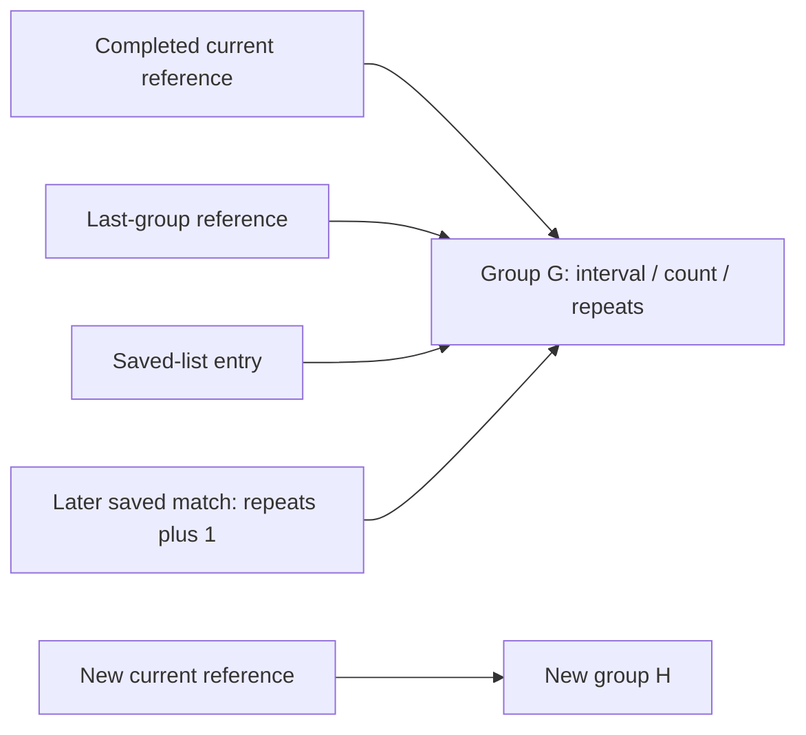

# 1. Result

E046 — Work1, 2026-11-13, Asia/Bangkok. Original-static research source:
canonical `main` **fadeca62227b94b25fa3d940e5ecf85453482bfc**. No exception.
No reconstruction, historical research/QA, prior fixture or old journal bytes
are changed. Publication adds only E046 artifacts and a journal suffix.
The exact publication SHA is the verified canonical-main commit containing
this report, supplied in the completion handoff rather than hashed into itself.

**Both principal mathematical histories are independently closed for the
specified finite circle profiles.** A separately written equation/identity-heap
oracle agrees with the unchanged E045 research projection at individual group
mutations, visibility terms, all three component states, aggregation, final
Double, cached Single bits and displayed magnitude. The six E045 non-golden
traces receive new independent comparisons here; their historical evidence and
classification are not overwritten.

This supports a **separately authorized restricted circle-only mathematical
implementation** under the stated preparation/numeric assumptions. It does not
authorize R17, establish a complete original provider/manager, or establish
slider/spinner/mod difficulty, general stacking or original-runtime equivalence.

| Verified before decoding | Bytes | SHA256 |
|---|---:|---|
|`osubackup.zip`|78,546,961;18 entries|`7089d49fe3e91be66e026b1d1a3245503f65580879b20bb81e7d97dd8534b738`|
|member `osu!.exe`|4,541,728|`6e182c10d1813209d12753dbc70b3a5bba00fef4ecf64bc42051870e6dfe4b7d`|

Self-reported Stable40/1.3.3.8 remains historically unauthenticated as an official
dated build. Findings apply to the pinned bytes only. No original CLR/game/native
method, E020 runtime experiment, reconstruction window, audio or asset extraction
is executed. Historical2,175 reconstruction QA checks are **not rerun**.

## Deliverables, independent boundary and reproduction

The original-static packet is `re/evidence/46/rhythm-visibility.json`. It retains
the full E045 body/metadata scope and adds exact source fingerprints and E046
group/visibility relationships. The new checker uses the unchanged independent
E044/E045 byte auditor, plus literal alias stores/getters/setters and local
assignments. It reparses the archive; it does not trust collector conclusions.

`independent_oracle.py` imports **only math, struct and collections**. Its expected
side cannot call the E044/E045 projection. It uses integer group identities in
an explicit heap, independently indexed visibility histories, explicit Single
vector stores, a separately calculated component-state sequence, and an offline
duration sweep with a dequeue/append prefix transform. `finite_inputs.py`
supplies deterministic inputs, not expected values. Closed-form rhythm and
visibility expressions independently anchor the oracle itself.

`rhythm_visibility_projection.py` is explicitly the **observed side**. It calls
the unchanged E045 research mathematics. For group traces only, a temporary
Pattern subclass appends actual object-reference registry ordinals to snapshots;
the registry retains objects to prevent address reuse. It neither changes arithmetic
nor replaces an object with a value copy, and restores the original class in a
finally block. This is in-memory research instrumentation, not an edit to E045.

The gate has **88 separately named finite controls**, including28 complete
prepared-chart comparisons:19 new admitted raw fixtures,3 artificial window100
controls and6 reassessed E045 inputs. Raw admission final checks, identity/mutant
controls and independent scalar anchors have their own classifications. These
counts overlap by purpose and must not be added together as new tests. Each
whole-chart case checks all meaningful intermediate records; individual scalar
fields and the19 source files are not additional named controls.

The corrected full gate **passes88/88**, including all28 complete intermediate
comparisons. Static scope is354 MethodDefs/337 nonzero-RVA bodies,394 fields,
65 types,23 declared slots,2,515 focused call edges,3,021 watched-field sites
and1,589 direct watched-call sites. The scan decodes19,659 bodies with1,739
zero-RVA entries and no errors. The auditor checks40 E044,40 E045 and24 E046
literal relationships plus five independently decoded strings. Two final
extractions are identical:2,641,711 bytes, SHA256
`8bdd62c91eeb6470c45cc88a9e9df9c216abda2e583253994b3029625a1661ce`.

Historical reruns pass: E043's73 relationships/19 projections/277 body audits,
E044's82 finite controls/335 bodies and E045's175 finite controls/337 bodies,
with their documented source-manifest/failure-capture boundaries. Relevant
unchanged E004/E005/E006/E023/E032/E033/E034 relationship checks also pass.

`results.json` retains expected/actual histories and final values. `coverage.json`
links the E045 conditional rows to new coverage. `trace-reassessment.json`
preserves each old non-golden classification alongside the new result.
`verification.json` pins exact original/body/extraction/source/fixture hashes,
counts, historical checker outcomes and preservation. No failed mathematical
assertion or corrected expectation is invented; any actual failure is retained
under this expedition's failure capture. E044/E045's prior failures remain
unchanged.

The first full E046 gate reached result serialization after its byte and finite
checks, then failed because relative `__file__` was compared with absolute ROOT.
The failure handler encountered the same path error. `failures/failure-01.json`
and `initial-packet.json` retain the failing source, input packet and error;
`disposition.json` records the correction to resolve the source path first.
No mathematical source, expected value or historical assertion was changed by
this correction. The corrected full gate is rerun before publication.
Its passed constructor-tag observer run is retained under `runs/` before the
final observer strengthening: copied tags could conceal a hypothetical deep copy,
so final observation uses actual references. This changes tracing/provenance
only, not E045, the independent oracle or mathematical expectations.

With the existing Python3.12, dnfile0.18.0, dncil1.0.2 and pefile2024.8.26:

```text
python re/tools/rhythm_visibility_evidence.py /path/osubackup.zip /tmp/e46-a.json
python re/tools/rhythm_visibility_evidence.py /path/osubackup.zip /tmp/e46-b.json
python re/tools/check_rhythm_visibility.py /tmp/e46-a.json /path/osubackup.zip /tmp/e46-results.json
python re/evidence/46/run_historical.py /path/osubackup.zip /tmp/e46-history
```

Compare the two collector outputs byte-for-byte. The local Windows command prefix
is `rtk proxy`; existing private Python dependencies are supplied on the import
path. No SDK, media device or original CLR is needed. Finite controls may also
be run through the checker's `finite()` without an archive audit; that preflight
alone is not the full original-byte gate.

# 2. What they found

**CONFIRMED STATIC** denotes original instructions/metadata; mathematical aliases
and state interpretation are **RECONSTRUCTED**. **VERIFIED COMPONENT** means the
specific executed research calculations, never original CLR execution. The
research-only numerical profile and instrumentation are **ENGINEERING**.
All original x86/JIT/native/provider/scheduler behavior remains **UNVERIFIED
ORIGINAL-RUNTIME**. Tokens M/F/Txxxx mean0600/0400/0200xxxx. Offsets are CIL-relative
hexadecimal offsets, excluding method headers.

Preparation reviewed standing instructions, both journals, E043 cache provenance,
full E044/E045 reports and parsed evidence/control matrices, all six E045 traces,
the preserved fixture correction, E004/E005 loading, E006/E032 geometry exclusion
boundaries, E010 timing, E023/E033/E034 separation and R16/QA14 context. No modern
alternative difficulty algorithm, K multiplier, score fitting or pp formula is
used. The Joined Bézier discrepancy remains deferred.

## Preserved circle type and preparation authority

E045's correction remains authoritative: circle T094c→T035a→T04c3→T0828→T01dc;
slider T02af→T0339→T04c3; spinner T00d8→T067f→T04c3. Circles do not assign to
T0339. The excluded original travel/type arms are justified by those actual type
tests, not guessed zero factors. E044's incorrect explanatory sentence is not
edited. E005's corrected ordinary-standard factory identification is retained.

The raw subset stays v14/Mode0/no-mod/circle-only with explicit StackLeniency0,
strictly increasing Int32 times, bounded finite positions, explicit supported
CS/AR/OD and viewport/time shift. The original M28eb time-gap exits make all stack
counts zero under these conditions, and M24b0 therefore applies zero displacement
to F252c. No equal-time registration rule or nonzero-stack model is introduced.

Input preparation still distinguishes raw rows, registered objects and N−1
difficulty pairs. Pair history is built before current-start sorting. The new
inputs have increasing registered times, so no alternate tie ordering is assumed.
Single normalization and nullable angles follow E045. The independent oracle
derives manager operands separately: CS5/AR5/OD5 at512×384 yields radius
32.013118743896484, preempt1200, window99; AR10 changes preempt to450. Shift0 is
explicit in the new raw inputs. Provider validity and complete original loading
remain conditional, not established by the research reader accepting text.

The executed new raw profiles are CS5/OD5, AR5 or10, viewport512×384 and shift0.
The six reassessed prepared profiles explicitly supply radius50/preempt1200/
window99. Other scalar/viewport combinations accepted by the strict reader are
not promoted to executed coverage by acceptance alone.

## Rhythm group identity and mutation

T0326 fields are **F0daf interval:Int32**, **F0db0 count:Int32** and
**F0db1 repeats:Int32**. M1746 initializes count/repeats1 and sets the supplied
interval through M1748. M174d handles the sentinel once and increments count.
M174e tests positive counts/parity and strict tolerance; M174f tests exact counts
and strict tolerance. M174b/M174c read/write repeats.

M1744's important reference relationships are explicit:

```text
02ef–0302  enumerate saved references into local11
0308       saved.same(current,tolerance)
0313       last.same(current,tolerance)
031a–0328  saved.repeats = unchecked(saved.repeats + 1)
03b7–03ba  savedList.Add(current reference), no copy/new group
0419–041a  last = current reference
041c–0423  current = new T0326(interval)
```

The observed identity-decorated trace and independent heap agree on these
references. At first saved insertion, the list entry and last-group identity
are equal. Later repeats mutate the same saved identity after insertion.
The trace retains each old/new list state and counter, not merely the final
number of groups.



An important limit on the requested alias discriminator: insertion followed by
new current construction means this path does **not** keep incrementing the saved
group's count as if it were still current. In the reached examples, later saved
mutation is its repeats field. A deep-copy insertion mutant has a different
identity graph but can return the same scalar when its persistent saved copy
receives the same repeat updates. Therefore **scalar equality alone cannot
prove alias correctness**. The gate independently checks the graph and tests
this numerical non-discriminator explicitly; it does not invent a chart where
an unreachable aliased count mutation changes the score.

## Independently closed repeated-pattern scalar

One anchor has source intervals `[300] + [100,100,200]×6`, radius50, preempt1200,
window99. The last pair's original seed walk reaches four completed count2
groups. Their selected interval is100, with weights1/3,1/2,2/3,5/6. Initial
completed value is1; subsequent matching groups receive parity×.5 and equal
count×.5, then the actual repeat counter2,3,4 weighting. All relevant preceding
intervals100 exceed window99, so the reached doubletap factor is exactly neutral
by its original predicate, rather than an unresolved term set to zero.

Independently define

```text
E = 2.75 / (1 + Exp(.24*(58.33-100)))
terms = [1/3,
         Sqrt(.25*Pow(2,-E))*(1/2),
         Sqrt(.25*Pow(3,-E))*(2/3),
         Sqrt(.25*Pow(4,-E))*(5/6)]
sum = 0.5652670333869401 (declared binary64 profile)
M1744 = Sqrt(4 + .95*sum)/2
       = 1.065012169146155
```

The checker evaluates this expression independently of the heap oracle and the
observed projection, then compares both. Omitting repeat updates gives a
different multiplier; a named mutant control requires the difference. The
matching intermediate group identities, counters and contributions are saved.

Further complete chart comparisons cover distinct completed groups, equal counts
with different intervals, different counts, a saved match after a nonmatching
group, tolerance-near intervals, alternating acceleration/deceleration, and the
finite capacity/history windows. Three artificial full-window100 cases isolate
interval differences29/30/31 at exact tolerance30. That exact equality is not
misrepresented as a source-chart OD window from the ordinary odd-integer
full-window formula.

The capacity is Min(index,32); seed processing is not assumed to have32 entries.
Independent dense controls expect28/29/30/30 comparisons for32/33/34/35 source
objects. Independently constructed5000ms controls expect5/4/4 comparisons for
the before/equality/after operands999/1000/1001 in the stated history. Equal
intervals still return1 while the processed histories differ. Raw/clamped
intervals, strict comparison and the final count attenuation remain separate.

Corpus labels do not substitute for reached-branch evidence. In particular,
`capacity-below` ends at selected capacity32; the exact below/equality/above
controls are V032–V035. Raw `age-below/equal/above` vary the last interval
1999/2000/2001, rather than asserting total5000ms history age. The exact5000ms
controls are V029–V031. `coverage.json` records actual capacities, seed lengths
and reached group flags for every chart.

## Dense visibility and independent indexed history

The independent oracle represents history by original pair indices rather than
the projection's moving recent/previous/earlier references. For backward offset k,
it derives those references as i−k, i−k+1 and i−k+2, with the original nullable
angle eligibility. Its prior-processed timestamp controls the2000ms stop, so the
new entry can cross the boundary during evaluation.

Forward and backward lists retain original traversal order. Both stop at their
first failed preempt/3000ms condition; they are not separately filtered/sorted.
M368f's start guard and preempt/fade arithmetic supply each visibility weight.
The oracle records each candidate, contribution and sum, plus cap and spacing
operands for angular terms.

At a right-angle square history with100ms intervals and the eighth pair index,
six eligible predecessor angles each contribute1. Consequently M1e5e returns
**1/3**. With prepared radius50, jump200 and preempt1200, the independently
summed backward and forward weights are **8 and3**. With jump400 and preempt450,
the sums are **2 and1.875**, and both the movement and short-preempt visibility
terms are positive. The independent expression is:

```text
A = 1/3; V = jump/100
Froot = Sqrt(forward) * smoother(followingJump,15,150)
M = Pow(Max(0,Pow(backward+Froot,1.7)*.4*A*V-2.5),.45)*2.4
P = Pow(Max(500-preempt,0),2.5)/140000*A*V
raw = Pow(Pow(M,1.5)+Pow(P,1.5),1/1.5) / (1-Pow(.8,.1))
```

These expressions are evaluated outside both general algorithms and compared
with each. They preserve the exact following-pair input. The source stack proof
remains M1e57:0028 M2cb6(0) through0069 M1e58, not a current-jump substitute.
New raw fixtures have zero, small and large next jumps, nullable final next pairs
and a following pair outside the visibility window. Candidate presence, numerical
influence and early termination are recorded as distinct facts.

Independent angle controls also close the post-update boundary: intervals499,
500,501 and600 process5/4/4/4 eligible terms respectively in the specified square
history. Each term has temporal factor `1−(dt−200)/1800`, producing a separate
closed full scalar. Artificial mixed-angle controls isolate the cosine cap
`Cos(pi/2)` and a spacing25 quintic gate yielding three `Sqrt(.5)` terms, hence
`2/(3*Sqrt(.5))`. These controls are explicitly prepared-angle controls, not
claims that arbitrary nullable angle arrays came from an admitted raw chart.

## Whole-chart integration and the six previous traces

The expected oracle independently derives geometry, movement/velocity terms,
group state and visibility contributions. It updates the original three mutable
states with distinct.2/.3/.8 bases; the third decay consumes unclamped delta.
The movement duration envelope is calculated by an offline sweep over already
computed states, then a separate queue formulation of the growing4000-duration
prefix. Per-object positive sorting, first-minute preprocessing, original s20/s1
weights and final E044 formula remain unchanged. Final Single bits and floor
display are checked separately from approximate Double agreement.

The combined-repeat-visibility raw chart has genuinely active repetition updates,
forward/backward visibility and short-preempt and movement visibility terms.
Its independently calculated aggregates are approximately
`[2336.2016888390713,435.7016415760794,199.55909217927814]`; final Double is
**5.119475874072683**, cached Single bits (little endian) **bfd2a340**, display
**5.11**. These are research-model numbers under explicit preparation, not
stars observed in the original game.

All six former E045 traces now have new independently executed complete numerical
comparisons, including every reached group/visibility intermediate. Their old
records stay labelled non-golden in E045; only the E046 reassessment adds closure:

| E045 input | New independently compared Double, approximately | E046 disposition |
|---|---:|---|
|regular|5.627450242938406|Prepared numerical profile closed|
|alternating|4.829656052634754|Prepared numerical profile closed|
|perturbed|5.975970289986771|Prepared numerical profile closed|
|long-pauses|1.7811920364433194|Prepared numerical profile closed; visibility legitimately0|
|same-position|13.276890545898917|Prepared numerical profile closed; interval contribution survives|
|right-angles|0.8471012936611392|Prepared numerical profile closed; sparse visibility legitimately0|

Last-bit differences between independently expanded Double expressions are
reported, not suppressed by rounding the final text. All stored Single cache
bits agree for these cases. None of the earlier six traces is retroactively
counted as an independently executed E045 test.

## Precision, preservation and readiness

The profile preserves explicit Int32 arithmetic/conversion, Single vector stores,
nullable branches, strict/inclusive traversal predicates and Double Math inputs.
The independent equation formulation sometimes associates real expressions
differently from the instruction-order observed model; scalar tolerance is
5e−12 relative /5e−13 absolute. Identity, group content, branch Booleans,
candidate indices, stored Single bits and display are exact comparisons where
applicable. The tolerance cannot forgive a different list, branch, counter or
cache bit. Original x86 extended intermediates, framework tie ordering and Math
last bits remain unmeasured; no bitwise original-JIT guarantee is made.
Malformed required history references outside normal boundary-null cases are
unsupported. Research exceptions are not silently converted into zero stars.

All895 prior tracked files and the483,804-byte journal prefix SHA256
`93acf9ce2b8ed8655feddfcb7a8397b3fd9db7249090d437db05c2d4a9083cee`
are protected. Historical E043 relationships/projections/archive checks and
unchanged E044/E045 numerical and original-byte functions are rerun with outputs
under evidence46. E045 functions are called directly rather than invoking its
historical failure-writing CLI, so an unexpected new failure cannot write into
old evidence. Exact outcomes and source hashes are retained. The old E043
pre-R16 reconstruction-source manifest remains explicitly outside the later R16
comparison; the historical checker itself is not weakened.

| Area | E046 disposition |
|---|---|
|Movement history / velocity-angle|Retained; independently expanded whole-chart comparison|
|Repeated-group rhythm|Ready for the bounded prepared-circle numerical profile; aliases and complete scalar independently checked|
|Dense visibility history|Ready for that profile; multi-angle, two-sided and following-pair effects independently checked|
|Both mechanisms combined|Ready finite combined raw case, all component states and final result checked|
|Aggregation / final Double / Single conversion|Retained, independently compared through final bits/display|
|Raw circle admission|Same supported strict E045 subset, explicit viewport/shift and no-stack proof|
|General circle-only mathematics|Ready for a restricted implementation under that declared profile; arbitrary original-runtime equivalence unproved|
|Nonzero stacking|Deferred|
|Complete original manager/provider|Deferred; no silent equivalence claim|
|Slider/spinner/mod mathematics|Deferred|
|General all-object R17|Not ready and not authorized|

The next implementation decision belongs to the owner. E046 removes the two
named independent mathematical validation blockers for this bounded profile;
it does not remove preparation/native precision limits or justify expanding
the supported domain. A separately authorized restricted circle-only milestone
is now mathematically defensible. R16's current Stars not calculated policy is
untouched. No R17, E047 or QA15 is begun.

# 3. Pseudocode

RECONSTRUCTED equations with CONFIRMED STATIC reference/branch authority;
VERIFIED COMPONENT applies to the finite research-model comparisons only.

```text
IndependentRhythm(pairs,i):
    heap = explicit group identities with (interval,count,repeats)
    current = new(MaxInt,1,1); last = new(MaxInt,1,1); saved = []
    capacity = Min(i,32)
    seed backward under capacity-2 and strict5000ms predicate
    for seeded comparisons in original forward order:
        derive raw/clamped intervals, tolerance and temporal/history weights
        evaluate interval-ratio shape and original transition gates
        mutate current count only on reached append branch
        if completed active group:
            apply parity, descending and equal-count factors
            locate first saved group satisfying strict content comparison
            if reached last-content match: mutate saved.repeats through alias
            apply original repeat exponent
            insert current reference if no saved match
            apply original doubletap factor
            accumulate original count-dependent contribution
            last = current reference; current = new group
    apply count attenuation, then Sqrt(4+.95*sum)/2

IndependentVisibility(pairs,i):
    enumerate past/future indices in original order
    stop on first failed preempt/3000ms condition
    accumulate original visible/spacing/time terms
    derive angle references using independent indexed equations
    test previous elapsed before processing next history entry
    preserve nullable angles, cosine caps and smoothers
    following = pair[i+1] or null
    gate sqrt(forward) with FOLLOWING jump where nonnull
    compute movement and short-preempt terms separately
    combine1.5 norm, normalize by original .8 factor

IndependentChart(preparedCircles):
    derive Single geometry and registered-order N-1 difficulty pairs
    compute movement, interval/rhythm and visibility raw terms independently
    update three original mutable states and capture every intermediate
    offline duration-envelope sweep → mutable queue-prefix transform → q0
    sorted positive interval/history values → q1
    first-minute transform BEFORE descending visibility aggregation → q2
    unchanged E044 final equation → Double → Single bits → floor display

Compare:
    independently reparse/hash original bytes, slots, fields, branches and locals
    expected oracle must import no projection implementation
    compare graph identities and every numerical intermediate
    require independent closed scalar anchors as well as general model agreement
    retain old E045 classifications; publish only new E046 comparisons
```
