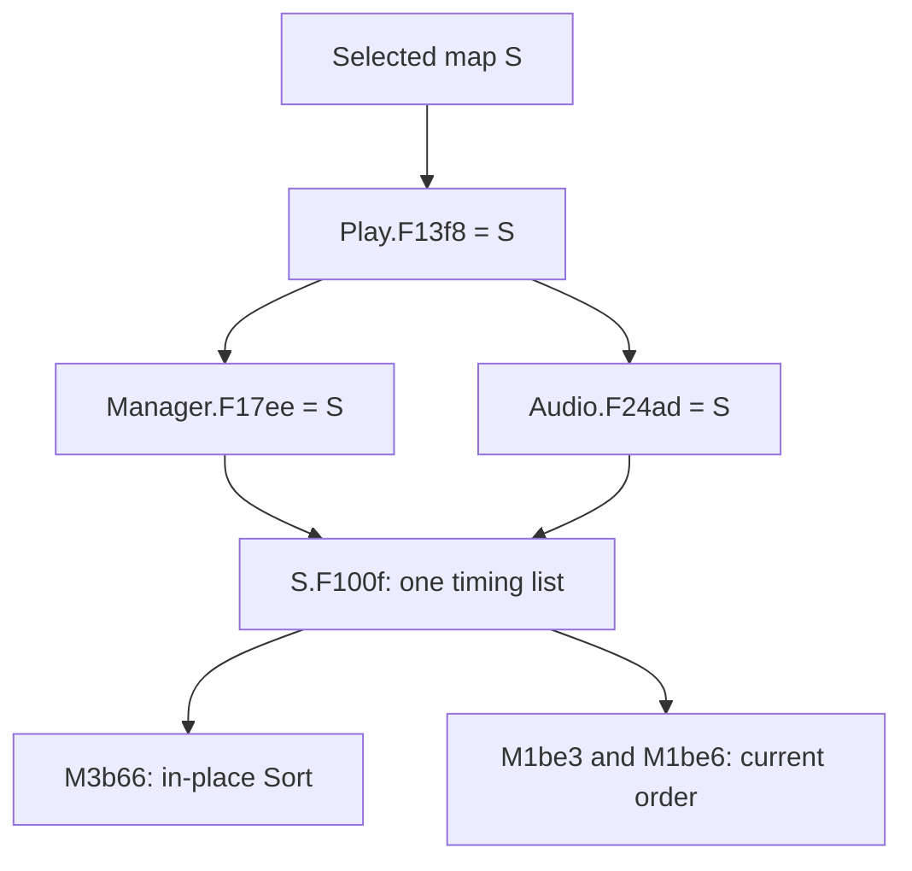

# Original list identity and initialization chronology

CONFIRMED ORIGINAL means selected original-static instructions, not runtime.
Exact code-relative hexadecimal call/field sites are checked by extract.py/check.py.

| Edge | Direct evidence | Identity implication |
|---|---|---|
| Selection -> Play | M2237:0001 M2c63;0006 stores F13f8 | Captured reference, not equal contents |
| Play -> manager | M223b:016e loads F13f8;0182 M28a2; M28a2:0001 argument1 ->0002 F17ee | Same map object |
| Play -> audio setup | M223b:015b M2240; M2240:00a3 loads F13f8,00bb M3b45 | Passed selected map |
| Reused audio -> map | M3b45:00b1/00b6/00b7 stores argument0 in current engine F24ad | Existing engine is rebound to passed object |
| New audio -> map | M3b45:00c8 M3d52,00d5 F2367; M3d52:0066–0068 stores argument0 in each non-null result.F24ad | Factory result retains passed map |
| Global -> list | M3b0e:0000 F2367,000b F24ad; M3b72:0000 getter,000b F100f | No copied list in either getter |
| Sort receiver | M3b66:0006 getter ->000b local0;002e local0 ->002f List.Sort | Mutates the same container |
| Late discrete request -> list | M24bb:0001 F152f ->0006 F17ee ->0014 M1be6; M1be6 reads F100f afresh | No encounter-order snapshot at request time |

| Stage | Reached ordinary successful path | Visible order |
|---|---|---|
| Metadata | M223b:008e M1bc1; refreshed metadata appends timing rows and stores F100f | Encounter order if newly parsed; caching/previous state is distinct |
| Audio setup | M223b:015b M2240 binds selected map to audio | Shared map/list, not a copy |
| Loader configuration | M28f5:007c–007f calls virtual M28be(false,true,true) | **EARLY forced sort**, before object parser |
| Early mutation | M28be:01af tests argument2;01b2 true ->01b3 M3b66 | Time ascending, base before inherited at equal time |
| Object construction | M28f5:00d4 M28f7; ordinary M48e0 makes/copies head sample banks | Already sorted timing; head bank snapshot is made here |
| Slider preparation | M28f5:0269 M28e9 ->M28ea:002e M144a; E005 speed and spacing lookups | Already sorted timing; rate/end/checkpoints are prepared once |
| Later initialization | M223b:024d M224d; M224d:0132 true ->0133 M3b66 | Sort again; equal-key tie ordering still unspecified |
| Gameplay discrete/global reads | M1be6 current map list; M3b61/M3b25 global timing updates | Current initialized list, not raw encounter order |

M28be is a virtual slot. Targeted metadata confirms ordinary T00e8 derives from
T0556 and neither overrides the slot nor supplies a MethodImpl for it. The special
T0680/M3206 override is explicitly excluded. No inference is made for that manager.
M28a3 on the selected base path is a one-byte return. The targeted M28f6/M28f7
paths have no direct F100f replacement or metadata-refresh call. Existing E040
writer inventory is reused; no global writer/body scan was repeated.

Successful non-null audio setup and reached ordinary loading are explicit
preconditions. Error recovery, editor/replay/conversion, special manager,
concurrent native callbacks and owner runtime remain unverified. The graph proves
the direct static alias/order chain; it does not claim every external call is pure.
